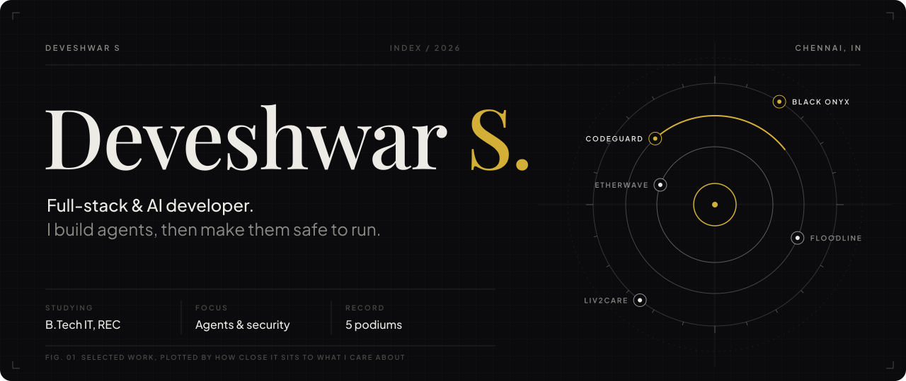
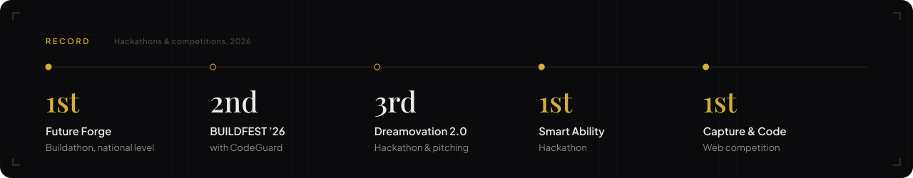
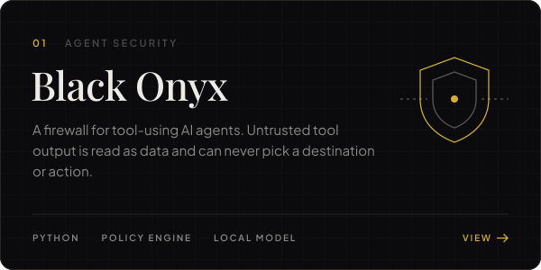
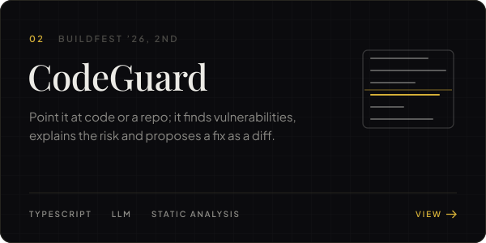
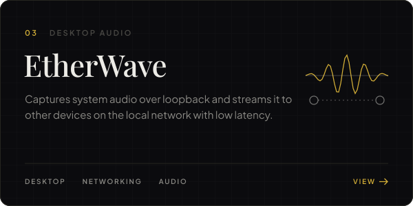
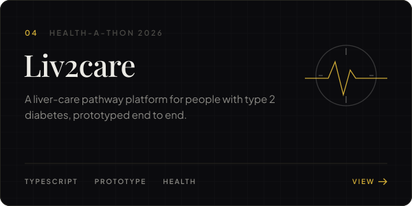
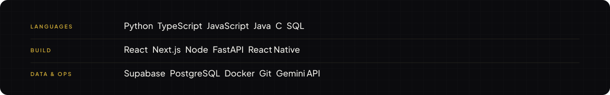

  <a href="https://portfolio-01-opal.vercel.app">Portfolio</a>&nbsp;&nbsp;·&nbsp;&nbsp;<a href="https://www.linkedin.com/in/deveshwar-s-19a67b362">LinkedIn</a>&nbsp;&nbsp;·&nbsp;&nbsp;<a href="mailto:deveshwars1905@gmail.com">deveshwars1905@gmail.com</a>

 

I'm a second-year IT student at Rajalakshmi Engineering College. Most of what I build sits where web apps meet AI models, and lately I've been most interested in the part nobody demos: keeping tool-using agents from doing things they shouldn't.

 

  
  
  
  

